# CodeArena Judge Engine — UML and System Diagrams

## 1. System Context Diagram

Shows how the Judge Engine communicates with the Laravel CodeArena application and the external programming language tools.

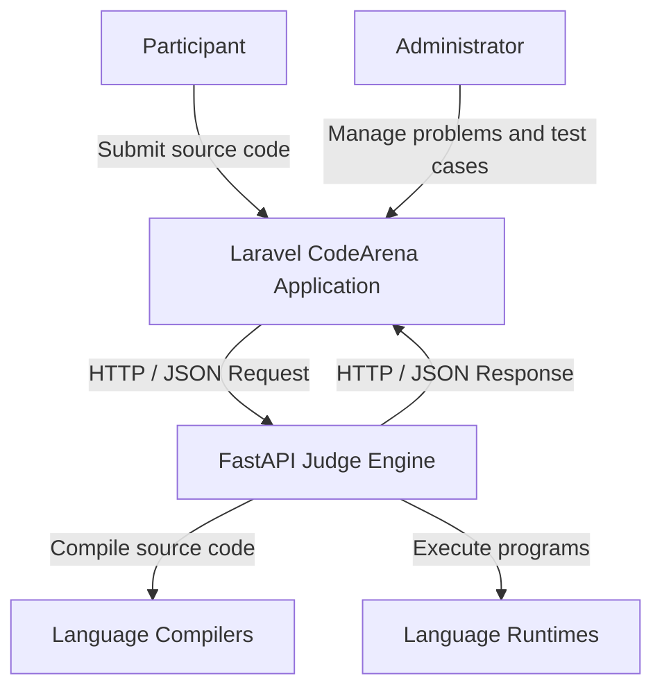

## 2. Use Case Diagram

Shows the main actors and their interactions with the CodeArena platform and Judge Engine.

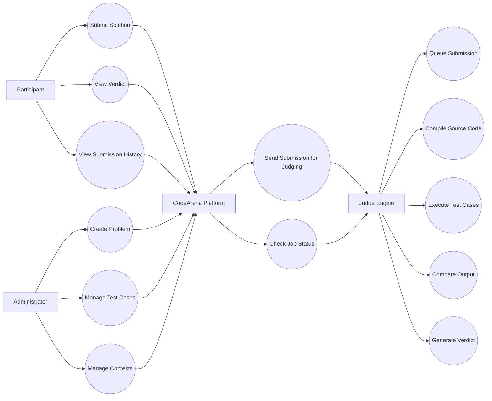

## 3. Class Diagram

Represents the main classes and their relationships inside the Judge Engine.

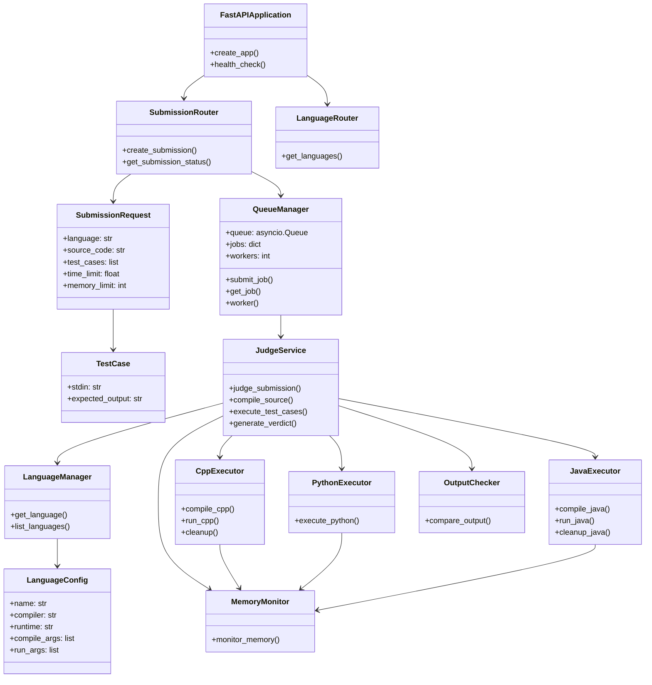

## 4. Submission Sequence Diagram

Shows the complete process from submitting source code in Laravel to receiving the final verdict.

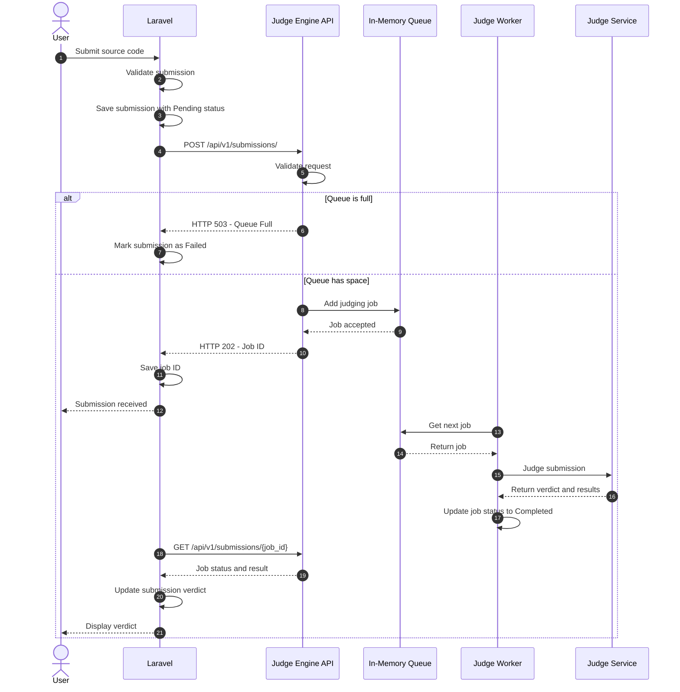

## 5. Internal Execution Sequence Diagram

Shows how the Judge Service processes one submission internally.

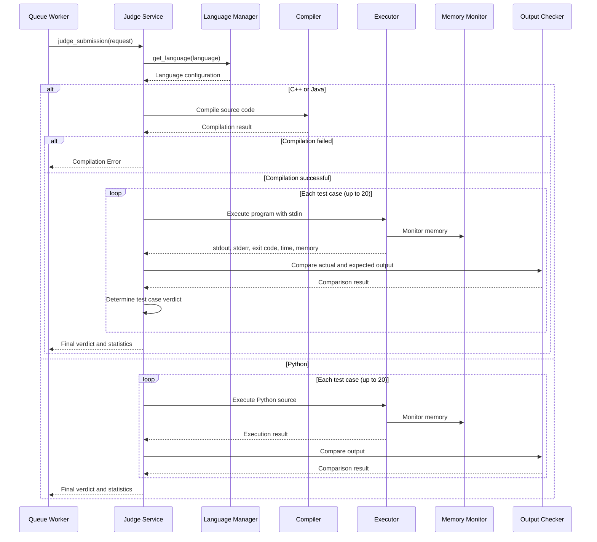

## 6. Activity Diagram

Shows the decision-making workflow of the Judge Engine.

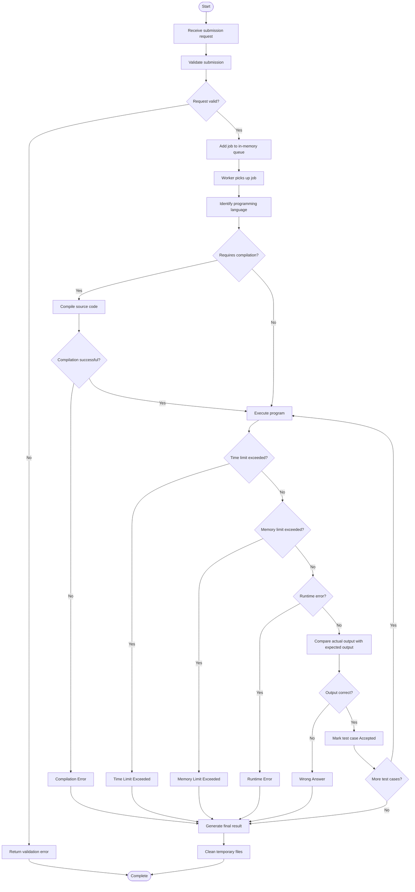

## 7. Component Diagram

Shows the logical organization of the Judge Engine.

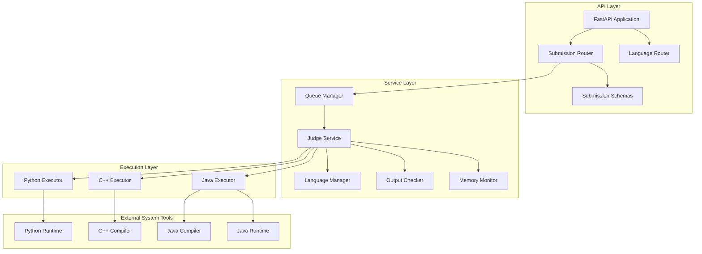

## 8. Deployment Diagram

Shows the current development deployment architecture.

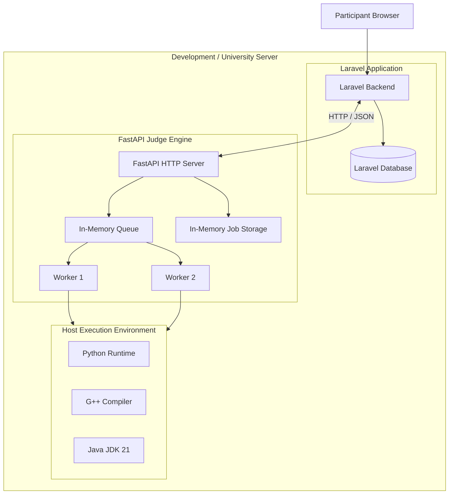

**Deployment notes:**

- Laravel owns the main application database.
- The Judge Engine is a separate FastAPI service.
- The queue is stored in application memory.
- Two workers process queued jobs.
- Python, C++, and Java are executed using locally installed tools.
- Redis is not currently required.
- Docker is not currently required.
- OS-level sandbox isolation is not implemented.
- Restarting the Judge Engine loses queued and in-memory job data.

## 9. Submission State Machine Diagram

Shows the possible states of a submitted job.

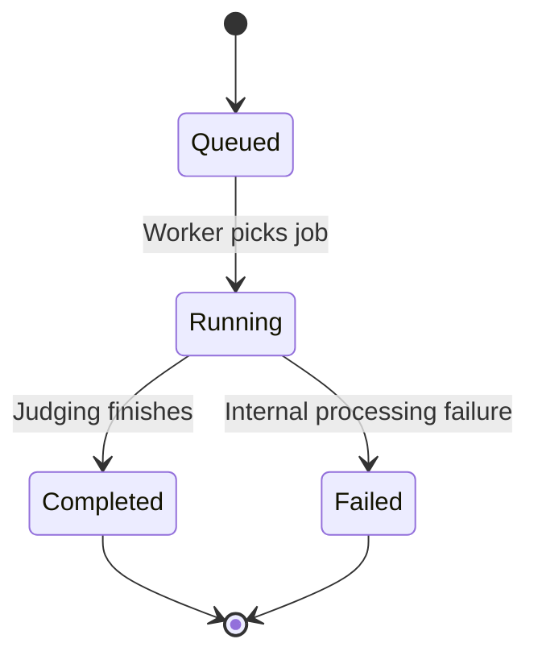

**Note:** The job state and the submission verdict are different concepts.

A job can be `Completed` while its verdict is `Accepted`, `Wrong Answer`, `Runtime Error`, `Time Limit Exceeded`, `Memory Limit Exceeded`, or `Compilation Error`.

## 10. Data Flow Diagram — Level 0

Shows the Judge Engine as a single process and its external communication.

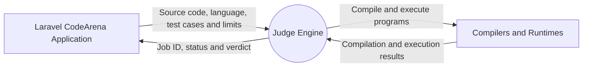

## 11. Data Flow Diagram — Level 1

Breaks the Judge Engine into its main processing functions.

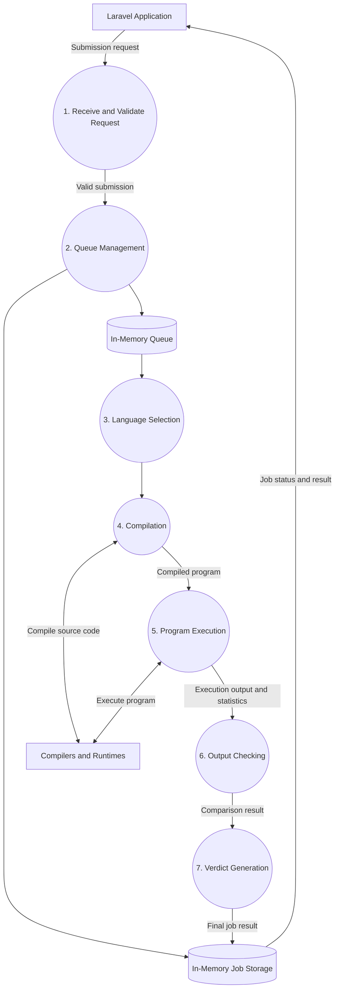

## 12. API Communication Sequence Diagram

Shows the API endpoints used by Laravel to communicate with the Judge Engine.

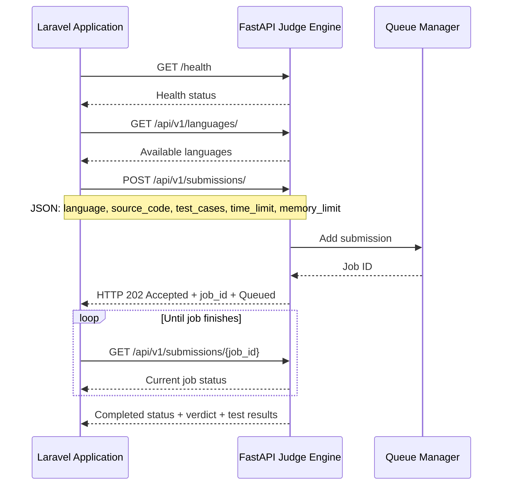

---

# Architecture Summary

| Component | Responsibility |
|---|---|
| Laravel CodeArena | Users, problems, hidden test cases, submissions, contests and database |
| FastAPI | HTTP API and request validation |
| Queue Manager | In-memory job queue and worker coordination |
| Judge Service | Compilation coordination, test execution and verdict generation |
| Language Manager | Language configuration and availability |
| Python Executor | Python source execution |
| C++ Executor | C++ compilation and execution |
| Java Executor | Java compilation and execution |
| Output Checker | Compare actual and expected output |
| Memory Monitor | Estimate process memory usage |

## Supported Languages

| Language | Compiler | Runtime |
|---|---|---|
| Python | Not required | Python |
| C++ | G++ | Compiled executable |
| Java | Javac | Java Virtual Machine |

## Current Judge Engine Configuration

| Setting | Current value |
|---|---|
| Backend framework | FastAPI |
| Main application | Laravel |
| Queue | In-memory asyncio queue |
| Workers | 2 |
| Maximum test cases per request | 20 |
| Supported languages | Python, C++, Java |
| Queue persistence | None |
| Redis | Not used |
| Docker | Not used |
| OS-level isolation | Not implemented |
| Communication | HTTP / JSON |

## Important Implementation Limitations

1. The queue and job records are held in memory and are lost when the service restarts.
2. The current execution environment does not provide OS-level sandbox isolation.
3. Memory monitoring is approximate and does not enforce a strict operating-system memory limit.
4. Each test case starts a separate execution process. C++ and Java compilation happens once per submission, while Python source is executed for each test case.
5. The Judge Engine is designed as a separate service; Laravel remains responsible for the application's business logic and persistent database.

**End of Document**
